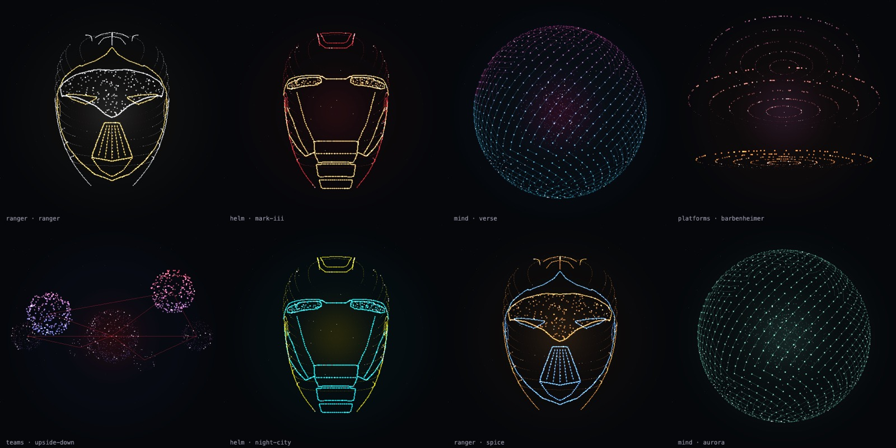

# aurora-field

A WebGL particle field (with a canvas-2D fallback) that assembles into shapes and morphs between them. It ships with a neural sphere with signals travelling its synapses, a team of orbs, a stack of platforms with traffic streaming through, an armoured helm and a ranger helmet. You can also give it **text, SVG paths, images or point clouds**, or draw **your own helmet** with `armour()`. It has two-tone pop-culture palettes, and options change live. It runs in a page, as a `<aurora-field>` web component, headless on an `OffscreenCanvas`, or in a **Web Worker**, off the main thread. Drag to spin it, move through it to part it, click to send a shockwave.

**[Live demo →](https://mutaaf.github.io/aurora-field/)** · seen on [mutaafaziz.com](https://mutaafaziz.com)




- **WebGL first.** Round, anti-aliased points at whole device pixels, with specular cores, soft halos and additive bloom, in three draw calls a frame. That's about 2,800 points by default (1,400 on phones) at 60 fps. Canvas-2D is the automatic fallback, and context loss is handled.
- **Zero dependencies.** One file, about 90 KB unminified (29 KB gzipped), and ES5, so it can be inlined into pages that support old devices. Also ships as an ES module, a web component and a worker bundle.
- **Any shape.** Helmets drawn from line art (`helm`, `ranger`, or your own via `armour(spec)`), plus `fromText`, `fromSVG`, `fromImage` and `fromPoints` factories. Flat sources still turn in 3D.
- **Two tones.** Palettes have an accent: the ranger's gold seams, the Mark III's gold faceplate. Eleven presets: `aurora`, `mark-iii`, `ranger`, `verse`, `barbenheimer`, `upside-down`, `night-city`, `spice`, `ember`, `ice`, `mono`. Colours morph with the shape.
- **Platform-agnostic.** DOM canvas, `OffscreenCanvas`, worker (`offload`), web component, server-side canvases, CommonJS, ESM or a `<script>` tag. Input works without DOM events through `field.pointer()`.
- **Configurable live.** `field.set({ palette, autonomy, depth, cycle, quality, rotation, … })` without a rebuild, and events through `field.on('shape' | 'settled' | 'stats' | 'spinout' | 'frame')`.
- **Alive.** Every particle is its own damped spring with its own stiffness, so the field swirls into shape instead of easing. Once there, it manages itself: points breathe, trade places with neighbours, send out scouts that orbit with a trail and come home, and light up as signals pass through.
- **Fast, and it says so.** `npm run bench` measures the CPU cost of a frame (physics, projection, building the draw batch). On an M-series laptop, v1.0 versus v0.6:

  | renderer | nodes | v0.6 | v1.0 |
  |---|---|---|---|
  | WebGL | 2,800 | 0.35 ms | 0.16 ms |
  | WebGL | 30,000 | 4.4 ms | 2.8 ms |
  | 2D | 2,800 | 0.47 ms | 0.39 ms |

  This comes from breathing without per-particle trigonometry (angle-addition tables) and depth curves as lookup tables, on top of typed-array state, cached shape builds and pre-rendered glows. With `offload()` the main thread does none of it. A governor watches the real frame rate and walks a quality ladder (resolution, then point density) down below 45 fps and back up above 57.
- **Deep and crisp.** Twelve depth layers under a strong perspective: far points are small, dim and fogged, near ones are large and saturated, with a one-pixel specular core. Everything is snapped to whole device pixels, so it stays sharp on retina screens.
- **Polite.** Pauses off-screen and in hidden tabs. Under `prefers-reduced-motion` it draws one still frame.
- **Deterministic when you want it.** Pass a `seed` and the same field is drawn every time.

## Install

```sh
npm i aurora-field
```

Or drop in one tag:

```html
<script src="https://unpkg.com/aurora-field"></script>
```

```js
import AuroraField, { create, fromText } from 'aurora-field';   // ESM
const AuroraField = require('aurora-field');                     // CommonJS
import 'aurora-field/element';                                   // defines <aurora-field>
```

## Use

```html
<section id="hero" style="position:relative;height:100vh;background:#0B0F12">
  <canvas id="field" style="position:absolute;inset:0;width:100%;height:100%"></canvas>
</section>
<script>
  const field = AuroraField.create(document.getElementById('field'), {
    shapes: ['mind', 'teams', 'platforms'],
    onShape: (name) => console.log('now showing', name),
  });
  // e.g. tie shapes to the words of a headline
  document.querySelector('[data-shape=teams]').onmouseenter = () => field.setShape('teams', { pin: true });
</script>
```

### As a web component

Works in plain HTML and in any framework that renders custom elements (React, Vue, Svelte, Angular, Astro).

```html
<script type="module" src="https://unpkg.com/aurora-field/dist/aurora-field-element.mjs"></script>
<aurora-field shapes="ranger,helm" palette="ranger" style="height:80vh"></aurora-field>
```

Every option is an attribute (`shapes`, `shape`, `rotation`, `palette`, `count`, `autonomy`, `quality`, `depth`, `cycle`, `seed`, `stars`, `interactive`, `worker`). `palette`, `shape` and the other live options update without a rebuild. It dispatches `shape`, `stats`, `settled` and `spinout` events, and `el.field` is the live field.

### Off the main thread

```js
const field = AuroraField.offload(canvas, { shapes: ['ranger'], palette: 'ranger' }, '/aurora-field.worker.js')
  || AuroraField.create(canvas, { shapes: ['ranger'], palette: 'ranger' });   // where OffscreenCanvas isn't supported
```

Physics and WebGL run in the worker (`dist/aurora-field.worker.js`). The main thread only forwards pointer input, resizes and visibility. Options must be clonable, so pass static shapes as `shapeData: { name: { points } }`.

### Headless

Any canvas without a document (an `OffscreenCanvas` you manage, or a server-side canvas) works when you pass a size: `create(canvas, { width, height, dpr })`. Drive input with `field.pointer('move' | 'down' | 'up' | 'leave' | 'pulse', x, y)`.

The canvas fills its `container` (default: its parent). Pass a `stage` element to place the shape inside a region, for example the right half of a hero, so it sits beside your text.

## Options

| option | default | |
|---|---|---|
| `container` | `canvas.parentNode` | element whose box sizes the canvas |
| `stage` | `container` | element whose box centres and sizes the shape |
| `count` | WebGL `1400` / `2800`, 2D `900` / `1600` | particle count (below / above 760px), or `(viewportWidth) => n` |
| `shapes` | all registered | shapes in the field |
| `rotation` | `shapes` | which of them auto-cycle, in order; the rest are reachable with `setShape` (a hidden helm, say) |
| `initial` | `shapes[0]` | first shape |
| `cycle` | `6500` | ms per shape; `0` turns auto-cycling off |
| `pin` | `14000` | ms that `setShape(name, {pin:true})` holds before cycling resumes |
| `intro` | `2600` | ms before auto-cycling may begin |
| `stars` | `140` | background stars (twinkle, slight parallax) |
| `depth` | `2.8` | camera distance in shape radii; lower is more dramatic perspective |
| `radius` | `min(w·.42, h·.36, 330)` | `(stageW, stageH) => px` |
| `autonomy` | `1` | `0…1`: breathing, place-trading, scouts, nodes lit by signals; `0` gives pure shapes |
| `renderer` | `'auto'` | `'webgl'` when available, else `'2d'`; force either |
| `quality` | `'auto'` | `'auto'` governs itself; `'high'` / `'low'` pin it |
| `fpsFloor` | `45` | the governor steps down below this |
| `interactive` | `true` | drag to spin, cursor parts the field, click for a shockwave |
| `autoPause` | `true` | pause when off-screen or the tab is hidden |
| `reducedMotion` | `'auto'` | `true` / `false` overrides `prefers-reduced-motion` |
| `seed` | `null` | number → deterministic field |
| `palette` | `'aurora'` | a preset name, `{ point:[r,g,b], accent:[r,g,b], hot, star, signal, head, glow, glow2, fog }`, or `{ preset, …overrides }` |
| `width`, `height`, `dpr` | | headless canvases: size in CSS px and the pixel ratio |
| `stageRect` | whole canvas | headless: `{ x, y, width, height }` where the shape sits |
| `shapeData` | | `offload()` only: static shapes to register inside the worker |
| `onShape` | | `(name)` when a shape becomes current |
| `onStats` | | `({ fps, nodes, quality })` once a second while running |
| `onSpinout` | | `()` when someone spins it really hard |

## API

```js
field.setShape('platforms', { pin: true })  // or { pin: 5000 }
field.next()
field.setPose({ yaw, pitch, roll, eyes })  // steer facing shapes (the helm) from a tracked head; null releases
field.anchors()        // the current shape's named anchors on screen: { eyeL: { x, y, z }, … } (z > 0 is turned away)
field.project([x,y,z]) // any shape-space point on screen, in CSS px within the container
field.view()           // { yaw, pitch, roll, radius, x, y }: the live orientation, for HUD readouts
field.set({ palette: 'verse', autonomy: 0.5 })  // change options live
field.on('settled', name => …)    // also 'shape', 'stats', 'spinout', 'frame'; field.off(name, fn?)
field.pointer('pulse', x, y)      // input without DOM events
field.pause(); field.play()
field.resize()      // after a layout change the window didn't announce; headless: resize(w, h, dpr)
field.stats()       // { fps, nodes, running, reduced, shape, quality, scouts, settle, renderer, headless }
field.destroy()     // removes listeners and clears the canvas

AuroraField.register(name, build | { points })  // add a shape, before create(); static data is resampled
AuroraField.build(name, n, seed)   // build a shape without a canvas
AuroraField.shapes()               // registered names
AuroraField.palettes               // the presets
AuroraField.offload(canvas, options, workerUrl)  // run in a worker; null where unsupported
```

## Custom shapes

A shape is a function that turns `n` particles into targets in a roughly unit box. Coordinates are in camera space: `+x` is right, `+y` is **down** and `+z` is **away** from the viewer, so a face that should look at you sits at negative `z`.

```js
AuroraField.register('ring', function (n, random) {
  var points = [];
  for (var i = 0; i < n; i++) {
    var a = i / n * Math.PI * 2, r = 1 + (random() - 0.5) * 0.08;
    points.push([Math.cos(a) * r, (random() - 0.5) * 0.06, Math.sin(a) * r]);
  }
  return {
    points: points,                 // required: n × [x, y, z]
    pairs: [[0, 1], [1, 2]],        // optional: edges that glow and carry signals
    links: [[[0,0,0], [1,0,0]]],    // optional: static segments drawn with the shape
    flow: function (i, t) {         // optional: per-frame target for animated points
      return null;                  //   (t in seconds; null means "use points[i]")
    },
    kick: 0.8,                      // optional: extra spin on arrival
    bright: [0, 1, 2],              // optional: points that glow while the shape is up
    facing: false                   // optional: turn and hold toward the viewer
  };
});
```

The demo registers a double helix this way; see `index.html`.

### From text, SVG, images and points

```js
AuroraField.register('hello', AuroraField.fromText('Hello', { font: '800 160px Inter' }));
AuroraField.register('logo', AuroraField.fromSVG(['M10 10 H90 V90 H10 Z', 'M30 30 H70 V70 H30 Z'], { tone: [0, 1] }));
AuroraField.register('photo', AuroraField.fromImage(imgOrCanvasOrImageData, { threshold: 0.4, tone: 'luma' }));
AuroraField.register('cloud', AuroraField.fromPoints([[0, 0, 0], [1, 0.2, 0.4] /* … */]));
```

- `fromSVG` parses path data itself (`M L H V C S Q T Z`, absolute and relative; arcs become lines), with no DOM. Outlines become joined particle lines that carry signals. Closed paths are filled even-odd, and `tone` picks a colour per path.
- `fromImage` takes `ImageData` (any `{ width, height, data }`), a canvas or an image. Bright or opaque pixels become points, with half of them on the outlines so the shape reads crisp.
- `fromText` rasterises with the platform's canvas (DOM or `OffscreenCanvas`).

### Faces: `setFace`

`helm` and `ranger` are rigged. Sixteen channels move soft regions of the drawing: `eyeBlinkL`/`R` close each eye onto its lid line (and dim its glow), `jawOpen` drops the mouth and chin, `smileL`/`R`, `pucker`, `press` and `mouthL`/`R` shape the lips, `cheekPuff` and `squintL`/`R` move the cheeks, `chinRaise` lifts the chin, and `browUp` / `browDownL`/`R` move the brows. Only the face moves; the back of the head never does.

```js
field.setFace({ jawOpen: 0.6, smileL: 0.4, smileR: 0.4, eyeBlinkL: 1 });   // a wink and a grin; values ease in
field.setPose({ yaw, pitch, roll, face });                                 // head and face together, from a tracker
```

The names map onto ARKit-style blendshapes (MediaPipe Face Landmarker, ARKit, Live Link) with a mirror for selfie views. Add a rig to your own helmet with `armour({ …, rig: [{ ch, box, move | squeeze | lid, mirror }] })`.

### Helmets: `armour(spec)`

`helm` and `ranger` are both built from a front-view drawing: a 1024-wide canvas, y down, crown near 172 and chin near 1120, with one scale for both axes. `armour` lays the drawing onto a real head volume, made of rounded-box cross-sections from a front silhouette and a side profile. Fills glow, and the sides and back become a holographic scan of contour rings.

```js
AuroraField.register('mine', AuroraField.armour({
  sil: [[172, 40], [400, 330], [800, 300], [1126, 90]],             // [y, half-width] down the face
  lines: [{ p: [[260, 600], [764, 600]], tone: 1 },                  // a brow, in the accent colour
          { p: [[300, 640], [420, 700]], mirror: true },             // drawn once, mirrored
          { edge: [640, 1110, 0.93], mirror: true }],                // a jaw along the silhouette
  fills: [{ p: [[280, 560], [460, 580], [440, 640], [290, 620]], share: 0.06, mirror: true }],  // glowing eyes
  anchors: { eyeL: [370, 600, 8] }                                   // for field.anchors()
}));
```

## How it draws

- **Physics.** Each particle is a semi-implicit-Euler damped spring toward the point it holds (ζ ≈ 0.75, ω between 4.2 and 8.5 per particle), plus a small swirl around the vertical axis while it travels, so arrivals spiral in.
- **Autonomy.** Particles hold a *point* of the shape, not a fixed slot (`TI` / `OWN` maps). Neighbours swap points a few times a second, scouts leave on short orbits, and every node a signal reaches lights up.
- **Drawing.** Every point is projected once per frame, then sorted into eight depth buckets. Each bucket is one `rect` path at whole device pixels, so 1,600 points cost eight fills, not 1,600. Edges are one stroked path. Glows (the core light, the halos on lit nodes) are pre-rendered sprites. Additive blending (`lighter`) gives the bloom without blur filters.
- **Convergence.** The field samples 64 points each frame to measure how close it is to its shape, and edges fade with that measure. The intro and every morph stay clean at any frame rate.
- **Governor.** One frame-rate check a second; quality steps down a rung below `fpsFloor` and back up after three good seconds.

## Develop

```sh
npm test              # builds dist/, then zero-dependency tests (shapes, determinism, ES5 guard, lifecycle, headless, factories, ESM)
npm run bench         # CPU ms per frame for 2,800 / 10,000 / 30,000 nodes, WebGL and 2D
npm run demo          # http://localhost:8080 (examples/element.html, examples/worker.html)
```

Edit `src/`; `dist/` is generated by `npm run build`, and CI fails if it's stale.

MIT © [Mutaaf Aziz](https://mutaafaziz.com)
