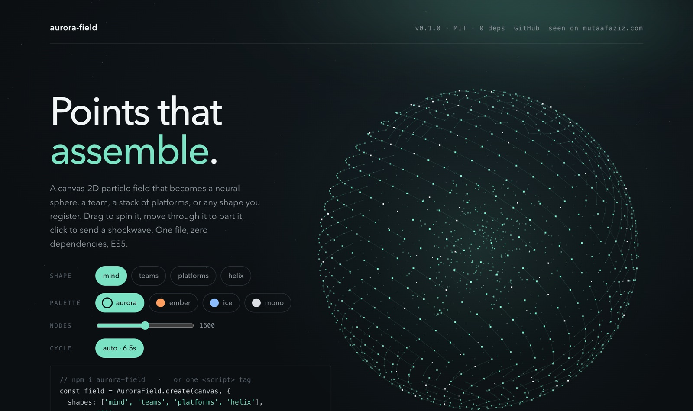

# aurora-field

A canvas-2D particle field that assembles into shapes and morphs between them: a neural sphere with signals travelling its synapses, a team of orbs, a stack of platforms with traffic streaming through, an armoured helm that turns to face you with glowing eyes, or any shape you register. Drag to spin it, move through it to part it, click to send a shockwave.

**[Live demo →](https://mutaaf.github.io/aurora-field/)** · seen on [mutaafaziz.com](https://mutaafaziz.com)



- **Zero dependencies.** One file, about 32 KB unminified (11 KB gzipped), and ES5, so it can be inlined into pages that support old devices.
- **Alive.** Every particle is its own damped spring with its own stiffness, so the field swirls into shape instead of easing. Once there, it manages itself: points breathe, trade places with neighbours, send out scouts that orbit with a trail and come home, and light up as signals pass through.
- **Fast, and it says so.** About 2–3 ms a frame for 1,600 points on a laptop with a retina screen. Particle state lives in typed arrays with no per-frame allocation, shape builds are cached, and the glows are pre-rendered sprites. A governor watches the real frame rate and walks a quality ladder (resolution, then point density) down below 45 fps and back up above 57.
- **Deep and crisp.** Twelve depth layers under a strong perspective: far points are small, dim and fogged, near ones are large and saturated, with a one-pixel specular core. Everything is snapped to whole device pixels, so it stays sharp on retina screens.
- **Polite.** Pauses off-screen and in hidden tabs. Under `prefers-reduced-motion` it draws one still frame.
- **Deterministic when you want it.** Pass a `seed` and the same field is drawn every time.

## Install

```sh
npm i aurora-field
```

Or drop in one tag:

```html
<script src="https://unpkg.com/aurora-field"></script>
```

Until the package is published on npm, copy `src/aurora-field.js`.

## Use

```html
<section id="hero" style="position:relative;height:100vh;background:#0B0F12">
  <canvas id="field" style="position:absolute;inset:0;width:100%;height:100%"></canvas>
</section>
<script>
  const field = AuroraField.create(document.getElementById('field'), {
    shapes: ['mind', 'teams', 'platforms'],
    onShape: (name) => console.log('now showing', name),
  });
  // e.g. tie shapes to the words of a headline
  document.querySelector('[data-shape=teams]').onmouseenter = () => field.setShape('teams', { pin: true });
</script>
```

The canvas fills its `container` (default: its parent). Pass a `stage` element to place the shape inside a region, for example the right half of a hero, so it sits beside your text.

## Options

| option | default | |
|---|---|---|
| `container` | `canvas.parentNode` | element whose box sizes the canvas |
| `stage` | `container` | element whose box centres and sizes the shape |
| `count` | `900` / `1600` | particle count (below / above 760px), or `(viewportWidth) => n` |
| `shapes` | all registered | shapes in the field |
| `rotation` | `shapes` | which of them auto-cycle, in order; the rest are reachable with `setShape` (a hidden helm, say) |
| `initial` | `shapes[0]` | first shape |
| `cycle` | `6500` | ms per shape; `0` turns auto-cycling off |
| `pin` | `14000` | ms that `setShape(name, {pin:true})` holds before cycling resumes |
| `intro` | `2600` | ms before auto-cycling may begin |
| `stars` | `140` | background stars (twinkle, slight parallax) |
| `depth` | `2.8` | camera distance in shape radii; lower is more dramatic perspective |
| `radius` | `min(w·.42, h·.36, 330)` | `(stageW, stageH) => px` |
| `autonomy` | `1` | `0…1`: breathing, place-trading, scouts, nodes lit by signals; `0` gives pure shapes |
| `quality` | `'auto'` | `'auto'` governs itself; `'high'` / `'low'` pin it |
| `fpsFloor` | `45` | the governor steps down below this |
| `interactive` | `true` | drag to spin, cursor parts the field, click for a shockwave |
| `autoPause` | `true` | pause when off-screen or the tab is hidden |
| `reducedMotion` | `'auto'` | `true` / `false` overrides `prefers-reduced-motion` |
| `seed` | `null` | number → deterministic field |
| `palette` | aurora | `{ point:[r,g,b], hot, star, signal:[r,g,b], head:[r,g,b], glow:[r,g,b], glow2:[r,g,b], fog:[r,g,b] }` |
| `onShape` | | `(name)` when a shape becomes current |
| `onStats` | | `({ fps, nodes, quality })` once a second while running |
| `onSpinout` | | `()` when someone spins it really hard |

## API

```js
field.setShape('platforms', { pin: true })  // or { pin: 5000 }
field.next()
field.pause(); field.play()
field.resize()      // after a layout change the window didn't announce
field.stats()       // { fps, nodes, running, reduced, shape, quality, scouts, settle }
field.destroy()     // removes listeners and clears the canvas

AuroraField.register(name, build)  // add a shape, before create()
AuroraField.build(name, n, seed)   // build a shape without a canvas
AuroraField.shapes()               // registered names
```

## Custom shapes

A shape is a function that turns `n` particles into targets in a roughly unit box. Coordinates are in camera space: `+x` is right, `+y` is **down** and `+z` is **away** from the viewer, so a face that should look at you sits at negative `z`.

```js
AuroraField.register('ring', function (n, random) {
  var points = [];
  for (var i = 0; i < n; i++) {
    var a = i / n * Math.PI * 2, r = 1 + (random() - 0.5) * 0.08;
    points.push([Math.cos(a) * r, (random() - 0.5) * 0.06, Math.sin(a) * r]);
  }
  return {
    points: points,                 // required: n × [x, y, z]
    pairs: [[0, 1], [1, 2]],        // optional: edges that glow and carry signals
    links: [[[0,0,0], [1,0,0]]],    // optional: static segments drawn with the shape
    flow: function (i, t) {         // optional: per-frame target for animated points
      return null;                  //   (t in seconds; null means "use points[i]")
    },
    kick: 0.8,                      // optional: extra spin on arrival
    bright: [0, 1, 2],              // optional: points that glow while the shape is up
    facing: false                   // optional: turn and hold toward the viewer
  };
});
```

The demo registers a double helix this way; see `index.html`.

## How it draws

- **Physics.** Each particle is a semi-implicit-Euler damped spring toward the point it holds (ζ ≈ 0.75, ω between 4.2 and 8.5 per particle), plus a small swirl around the vertical axis while it travels, so arrivals spiral in.
- **Autonomy.** Particles hold a *point* of the shape, not a fixed slot (`TI` / `OWN` maps). Neighbours swap points a few times a second, scouts leave on short orbits, and every node a signal reaches lights up.
- **Drawing.** Every point is projected once per frame, then sorted into eight depth buckets. Each bucket is one `rect` path at whole device pixels, so 1,600 points cost eight fills, not 1,600. Edges are one stroked path. Glows (the core light, the halos on lit nodes) are pre-rendered sprites. Additive blending (`lighter`) gives the bloom without blur filters.
- **Convergence.** The field samples 64 points each frame to measure how close it is to its shape, and edges fade with that measure. The intro and every morph stay clean at any frame rate.
- **Governor.** One frame-rate check a second; quality steps down a rung below `fpsFloor` and back up after three good seconds.

## Develop

```sh
node test/run.mjs     # zero-dependency tests (shapes, determinism, ES5 guard, lifecycle)
npm run demo          # http://localhost:8080
```

MIT © [Mutaaf Aziz](https://mutaafaziz.com)
